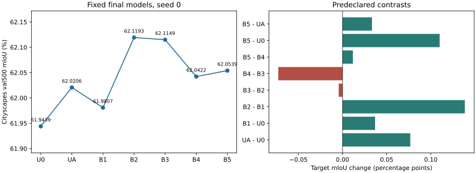
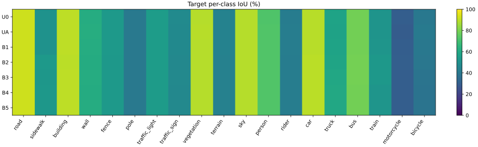

# HPI DINOv2 项目最终报告

七组 seed0 模型均完成 40000 更新，共 280000 次正式更新。Phase37 对七组固定最终头各评估 Cityscapes val500，新增更新为 0。七份整数混淆矩阵和图像清单已独立核对。

| 模型 | 可训练参数 | source mIoU% | target mIoU% | Anchor raw Var | Anchor RMS-norm Var | Residual raw Var | Residual RMS-norm Var |
| --- | --- | --- | --- | --- | --- | --- | --- |
| U0 | 3799828 | 72.4142 | 61.9439 | 0.00233112 | 0.00401489 | 0.000141161 | 0.00538936 |
| UA | 3799828 | 72.3767 | 62.0206 | 0.000807081 | 0.000782418 | 0.00122538 | 0.00098867 |
| B1 | 3760916 | 72.4013 | 61.9807 | 0.00247456 | 0.00397364 | 0 | null |
| B2 | 4882006 | 72.4495 | 62.1193 | 0.00240481 | 0.00386048 | 0 | null |
| B3 | 4882006 | 72.4771 | 62.1149 | 0.00259498 | 0.00388598 | 0 | null |
| B4 | 4882006 | 72.4607 | 62.0422 | 0.00260792 | 0.00390625 | 0 | null |
| B5 | 4882006 | 72.4340 | 62.0539 | 0.00261678 | 0.00393491 | 0 | null |

全部模型骨干为 DINOv2-L HPI-p16、seed=0。效应主表按 GT-present 类别先图内平均、再等权图像宏平均。平均绝对幅值、RMS、slot 责任与熵、class 责任与熵及 JS 见 models.csv；原始与归一化、二视图与五视图、逐类与 all-class 补充、相关与抵消及 null 计数见 diagnostics.csv。slot 主表取原图 GT-class 区域第 0 槽；class 取第 1 个干预视图的 all-valid 区域并按 GT-present 类别汇总。

| 预声明对比 | target 变化 pp | source 变化 pp |
| --- | --- | --- |
| UA - U0 | +0.076723 | -0.037498 |
| B1 - U0 | +0.036853 | -0.012814 |
| B2 - B1 | +0.138558 | +0.048113 |
| B3 - B2 | -0.004353 | +0.027666 |
| B4 - B3 | -0.072754 | -0.016391 |
| B5 - B4 | +0.011731 | -0.026733 |
| B5 - U0 | +0.110034 | +0.019842 |
| B5 - UA | +0.033311 | +0.057339 |

B2−B1 为 +0.138558 pp，是相邻消融中最大的正变化。B3−B2 为 −0.004353 pp，B4−B3 为 −0.072754 pp，B5−B4 为 +0.011731 pp。结果没有呈现逐项叠加的单调改善。B5 相对 U0 和 UA 分别为 +0.110034 pp、+0.033311 pp。差值均为单种子点估计。

主路径干预在冻结的 128 张源图上、对 GT-present 类别和五视图计算。main_path.csv 等权汇总各图，保留 on/off 概率、带符号效应、方差、正负及近零比例、gamma、gate 和注入 RMS。原始读出效应与主路径效应分别报告。

| 模型 | mean on | mean off | mean τ | Var τ | 负效应比例 | gate | 注入 RMS |
| --- | --- | --- | --- | --- | --- | --- | --- |
| B2 | 0.559939 | 0.443982 | 0.115957 | 5.55934e-05 | 0.079404 | 0.959272 | 0.0336234 |
| B3 | 0.56067 | 0.439443 | 0.121226 | 6.31282e-05 | 0.0743907 | 0.995582 | 0.0290626 |
| B4 | 0.560355 | 0.438933 | 0.121422 | 6.46551e-05 | 0.0735405 | 0.988516 | 0.0288652 |
| B5 | 0.56036 | 0.43897 | 0.121391 | 6.23247e-05 | 0.0736607 | 0.995262 | 0.0286038 |

B1–B5 的 Residual 是结构性零，RMS 归一化方差未定义。两个 Anchor 槽位重复，有效独立 Query 数为 1；责任高熵源自结构退化，不能解释为解耦。读出方差下降、Query 删除后的变化或 attention 图均不足以独立证明现实因果机制或泛化改善。新增模块和损失的效果归属于整个组合，未隔离为 Anchor 参数本身的效果。

运行环境为 RTX 6000D、PyTorch 2.7.0+cu128。训练逻辑 batch1，物理骨干视图 batch32；Phase35/36 使用 12 spawn worker、8 样本装载包、prefetch2 和双缓冲。U0/UA 复用 v2 已完成训练。源诊断修复后为 12 worker、实际装载 batch4，逐图恢复。工程分组耗时、峰值显存、功耗、遥测与稳态口径见 engineering.json。Phase35 稳态 GPU 活动中位数 68%，Phase36 为 62%，均低于 80% 工程目标；v3 计时提升 7.85%，低于 10% 目标。Phase34 全流程遥测包含长时间诊断，不能充当训练稳态。

Phase37 评估段耗时 141.883 秒，组级峰值 allocated 3.373 GiB、reserved 3.988 GiB。该耗时口径排除初始化，含本次记录恢复/读取；显存是七头共享组峰值。目标评估采用原生 1024×2048 整图 BF16、batch2 共享骨干特征、各头 argmax。

Phase35 由原训练 SHA c4a7b6f 完成 120000 更新，诊断在 3dfbdca 续跑，180+2317 张记录覆盖 2497 图，续跑更新为 0。最初准备曾缺少 PyYAML，已在正式运行前修复；可选 compile 失败后冻结 eager+SDPA。逐图、最终检查点和配置身份已分别冻结。Phase35 示例 ZIP 未在本地收到，保留远程哈希；Phase34/36 示例 ZIP 已核验。返回包未保留 Phase35 初次训练完整计时分项，engineering.json 用 null 保留缺失项。

| 历史背景模型 | backbone | GPU | target mIoU% |
| --- | --- | --- | --- |
| 旧 U0 | DINOv3-L/16 | RTX 4090 D | 65.2091 |
| 旧 UA | DINOv3-L/16 | RTX 4090 D | 66.0753 |

历史 U0 环境见 experiments/STRICT_DG_PHASE26/final_comparison.json，旧 UA 环境见 experiments/DIAGNOSTIC_20261020/phase29_acceptance.json。硬件与骨干不同，历史分数只作背景，不构成严格配对的骨干比较。

本研究为单训练种子，并在已知旧目标反馈后制定，结论限于探索性点估计。没有跨训练种子不确定性估计。实现只迁移 HPI 的去 VLM 骨干适配路径，未复现包含 VLM 的 HPI 全模型。全部八个预声明对比及负结果均已报告。

验收依据保存在 experiments/HPI_DINOV2_20261031/phase37_acceptance.json 和 target_freeze.json。源域包分别绑定 Phase34、35、36 验收清单。模型/优化器检查点与完整逐图记录保留 AutoDL，Git 保存精简结果及身份。Phase33–38 完成，本方案已结项。
