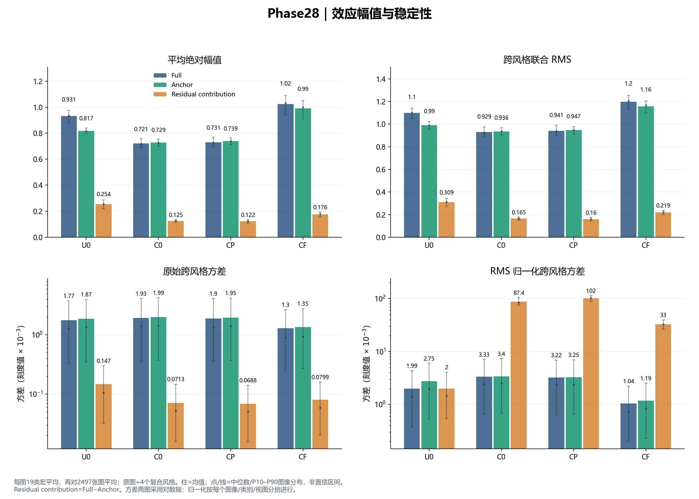
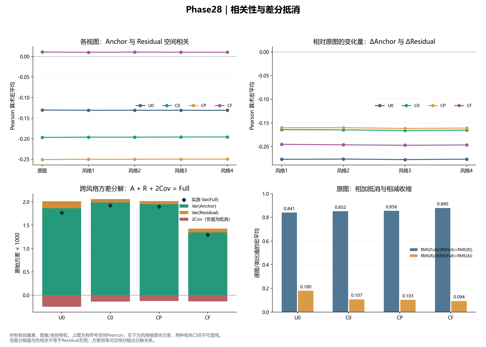
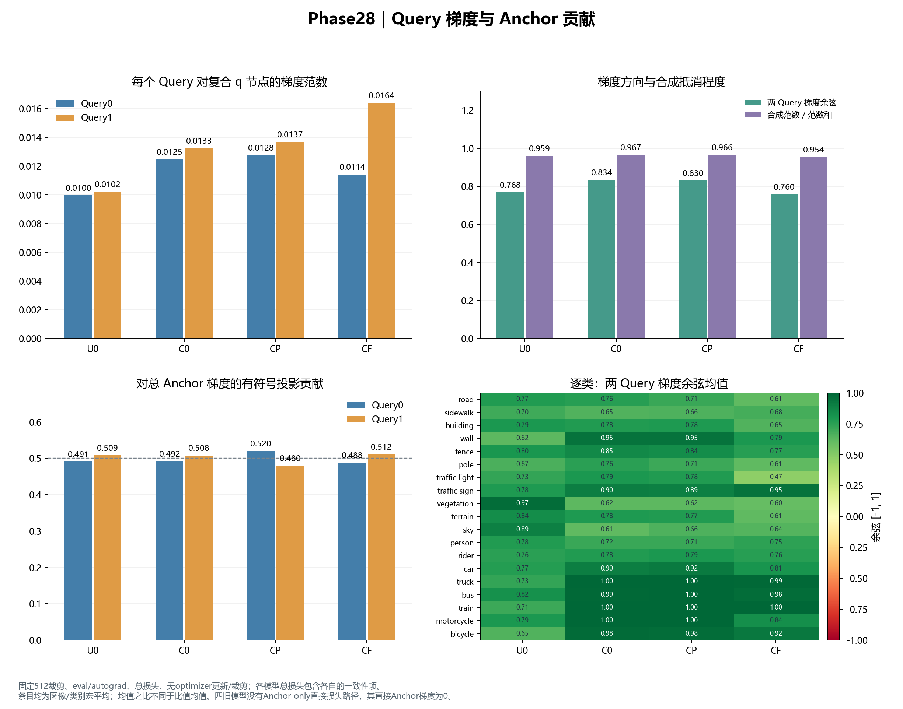
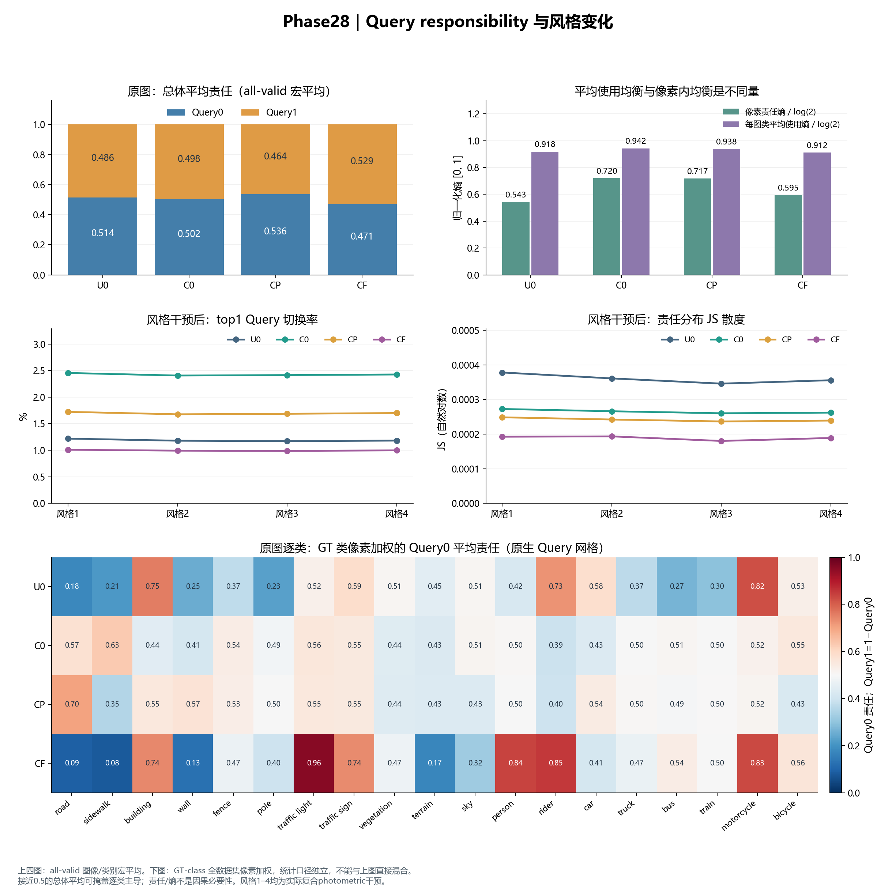
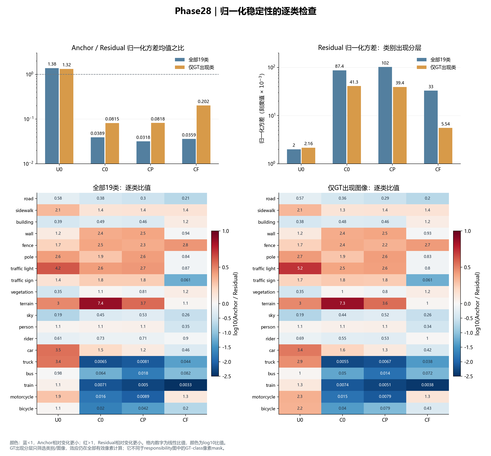

# Phase28：U0 / C0 / CP / CF 诊断图册

解读日期：2026-10-24。打开 `index.html` 查看全部五组图；每组提供PNG与SVG。`plotted_metrics.json`保存绘图数值、原始摘要SHA及生成脚本SHA。本次只读取现有Phase28结果，没有训练、推理或修改任何实验配置。

| 名称 | 原模型 | residual中心化 | 一致性项 |
| --- | --- | --- | --- |
| U0 | M0 | 关闭 | 无 |
| C0 | M1 | 开启 | 无 |
| CP | P1 | 开启 | 预测KL |
| CF | M2 | 开启 | Full CQE |

每模型为同一训练种子、最终40000步，诊断覆盖2497张GTA5源域图像。效应使用原图和四个实际复合photometric视图；梯度使用固定512裁剪、eval/autograd、原图和第一干预、各实验自己的总损失。效应定义为Full=alpha×Query分支输出，Anchor=重复Anchor通过同一head的输出，Residual contribution=Full−Anchor。

## 1. 幅值与稳定性

原始方差依赖幅值，RMS归一化方差强调相对空间变化，二者不能互相替代。C0的Anchor/Residual原始方差均值之比为27.9238，归一化后为0.03887；这说明原始排序不是相对形状稳定性的排序。

CF相对C0的Full原始方差降低32.7%、归一化方差降低68.8%，联合RMS提高29.0%。这组稳定性指标改善没有伴随Full整体幅值收缩。CF的Residual原始方差反而提高12.1%、RMS提高32.4%，归一化方差降低62.2%；不能把它写成所有分量绝对波动都下降。

柱为图像/类别宏均值，点和线为图像宏统计的中位数与P10–P90分布，不是训练种子置信区间。两张方差图用对数坐标，标注数字与刻度需乘10⁻³。

## 2. 分量相关与抵消

四模型的Anchor/Residual跨风格协方差均为负，Full方差中存在分量变化抵消。原图空间Pearson均值分别为U0=-0.1302、C0=-0.1968、CP=-0.2507、CF=0.0108。CF的原图相关接近零，但其风格变化量相关仍约-0.195，不能说两分量已经独立。

下图使用恒等式Var(Full)=Var(Anchor)+Var(Residual)+2Cov。它只验证输出分解；空间Pearson不能代入风格维度协方差。低差分幅值也不足以证明Residual无用。

## 3. Query梯度贡献

总损失的两Query平均梯度方向余弦为0.7682/0.8336/0.8303/0.7596，合成范数比为0.9593/0.9665/0.9656/0.9544。没有总体严重相互抵消的证据；这也不证明两个Query已经互补或必要。部分稀有类别的平均方向余弦接近1，只说明梯度方向相似，不能单独据此认定功能完全重复。

两个Query对Anchor总梯度的投影贡献在总体上接近各一半。CF的Query1平均梯度范数较大，但不能把两个范数均值之比当作逐图类投影贡献的平均。四旧模型均无Anchor-only直接损失，直接Anchor梯度为0是预期结果。

## 4. Responsibility：总体均衡掩盖逐类主导

原图Query0总体宏平均责任为0.5136/0.5025/0.5364/0.4706，整体看都接近0.5。GT类像素加权后，CF却呈现明显的类别主导：traffic light的Query0约95.7%；road的Query1约90.8%；sidewalk的Query1约92.0%。这应被报告为局部类别主导，不能仅凭总体均值排除slot使用不均衡。

C0的GT类像素加权责任更均衡，最强单slot约63.1%；U0对应最大约82.2%。CF的风格切换率和JS散度较小，但更强的slot主导本身也可能减少top1切换，不能只凭低切换率认定分工更好。Responsibility不是因果必要性。

上四图使用all-valid图像/类别宏平均，下图使用原生Query网格、GT-class全数据集像素加权；这是两种不同聚合口径。

## 5. 逐类与GT出现分层

按每类的归一化方差均值比较，Anchor更低的类别数为U0=6/19、C0=9/19、CP=10/19、CF=13/19。C0的总体均值之比很低，但不意味着Anchor在每个类别都更稳定。C0的Residual归一化方差特别高的类别包括truck、train、motorcycle；这些类别对总体均值有较大影响。

CP的Residual归一化方差在全部类别口径中从C0的0.08743升至0.10212，而仅GT出现类的宏平均从0.04128降至0.03937。类别分层能改变局部结论，因此不能仅根据一个总体数字把预测KL写成全面有效或无效。

GT出现分层只筛选类别/图像，效应仍在全部有效像素计算；它不是只在对应类别GT区域计算效应。现有摘要不足以对“弱幅值差分的归一化放大”等解释作因果确认。

## 范围

这些图来自已接收的summary.json；没有重新计算远程逐图原始记录。没有逐图分割预测、像素效应热图或训练种子不确定性。源域诊断不直接证明目标域收益，Anchor/Residual的相关也不等于因果关系。无中心化U0的分解存在a+t、e−t不唯一性，不能把跨参数化的Anchor直接解释为同一个已识别语义实体。

复现：在本机执行 `python -m tools.plot_phase28_diagnostics`。不需要AutoDL；该脚本仅读取摘要并输出图册，不触及当前CA/CR训练。
