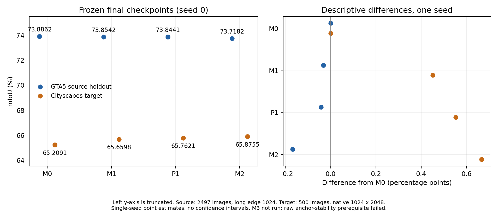

# CausalQ_DG_1016：正式对照结果与研究终止说明

更新日期：2026-10-19。Phase27 接收最终目标域报告并完成本轮归档。M0、M1、P1、M2 均已完成正式训练与最终评估；Anchor 稳定性前提不成立，M3 未启动。本轮没有待执行的 AutoDL 任务。

## 正式结果

四组均为 seed0、40000 次更新，使用固定最终检查点。源域为 GTA5 holdout 2497 张，目标域为 Cityscapes val500 张。mIoU 单位为百分比，差值单位为百分点。

| 变体 | 训练机制 | 源域 mIoU | 目标域 mIoU | 目标域较 M0 | 目标域较 M1 |
| --- | --- | ---: | ---: | ---: | ---: |
| M0 | 原始分解基线 | 73.8862 | 65.2091 | 0.0000 | −0.4507 |
| M1 | Centered 分解 | 73.8542 | 65.6598 | +0.4507 | 0.0000 |
| P1 | M1 + 预测一致性 KL | 73.8441 | 65.7621 | +0.5530 | +0.1023 |
| M2 | M1 + 原始 Full CQE | 73.7182 | 65.8755 | +0.6664 | +0.2158 |

M2 的目标域点估计在四组中最高，较 M1 高 0.2158 个百分点，而源域较 M1 低 0.1360 个百分点。因此，源域的小幅下降不能直接推导出域泛化下降，也不能将本轮写成“Full CQE 必然损害目标域性能”。M1 相对 M0、P1 相对 M1 的目标域点估计也为正。

这些差异来自一个训练种子、一个目标域，没有训练种子方差或显著性证据。它们支持描述本次观测，不足以确认稳定增益、Centered 的普适优势，或 Anchor-CQE 的有效性。四组全部报告，未根据目标域结果选择检查点或回调配置。

## 为什么没有继续训练 M3

方案第46节要求检验 Anchor effect 是否比 Residual effect 更稳定；若不成立，“必须停止继续堆 loss”。第55节同样要求在核心假设失败后停止叠加模块，第56节将 Geometry-aware 扩展置于 Anchor-CQE 已被证明有效之后。

Phase25 在正式 M1 的最终40000步检查点上覆盖全部2497张源域 holdout，执行4994次前向、零参数更新，返回结果为：

| 原始效应统计 | 数值 |
| --- | ---: |
| Anchor 方差 | 0.0009380707222222419 |
| Residual 方差 | 0.0000339865702574878 |
| Anchor / Residual | 27.6012176314 |
| Anchor 方差更低的图像 | 0 / 2497 |

该设定未支持 Anchor 更稳定的理论前提。M3 因此没有训练，不能赋予零分或称为性能失败；失败的是启动它所需的稳定性假设。M2 的正向目标域差值不能替代这项前提。当前研究按既定停止条件结束，不根据已看见的目标域分数重新设计损失。

本地接收的是固定哈希的统计证书及其来源信息；完整逐图原始效应记录仍在 AutoDL，未在本地独立重算。该限制保留于 Phase25 记录。

## 固定训练与评估口径

使用冻结 DINOv3-L 与可训练 Query 分支；四组共享初始化、源域划分、训练预算和运行环境。训练采用原图与 photometric 视图的交叉熵、512裁剪、batch1、BF16、AdamW，学习率1e-4、weight decay0.01、梯度裁剪1及40000步 polynomial 调度。Query 使用 static interaction、每类2个 Query，alpha 初始化为0并参与训练。M1 使用 `q = a + e - mean_R(e)` 的 Centered 分解。

P1 额外使用 `KL(detached original || photometric)`，温度和权重均为1，仅计算有效像素。M2 约束相加前的 `alpha * delta` Full CQE 效应：原图分支停止梯度、FP32逐类空间 L2 归一化、SmoothL1 beta1、权重1，按 GT 出现的类别聚合。具体实现及配置以冻结合同引用为准。

源域训练/验证数量为22469/2497，采用固定文件名 SHA256 排序回退划分。缺少 scene/sequence 元数据，相关帧可能跨训练与验证集。源域评估将长边缩放至1024并补齐至16的倍数；目标域评估使用原始1024×2048整图，无缩放、裁剪、翻转、多尺度、滑窗或 TTA。因此源域与目标域绝对分数之差也包含评估几何差异，不能单独解释为域偏移大小。

Cityscapes 的500个样本 ID、四组最终检查点及评估口径均在 Phase26 指标返回前冻结。四组目标域评估均为零优化更新，19类 trainIds、ignore255，相同917018489个有效 GT 像素。运行环境为 Python3.12.3、torch2.7.0+cu126、CUDA12.6、transformers4.56.1、RTX4090D；每组报告的峰值 reserved 显存为2.66796875 GiB。它是推理进程的分配器保留显存指标，不能作为训练显存测量。

本地对返回文件核验固定哈希，按四个19×19整数混淆矩阵独立重算类别 IoU 和 mIoU，并检查各模型 GT 类别像素计数一致、检查点身份及零更新标志。没有在本地读取源/目标图像、DINO 权重或实际检查点来重放评估。

四组 trace 哈希相同，因为 trace 只含样本 ID、预测形状和 GT 有效像素数，不含预测内容。四组聚合混淆矩阵不同；相同 trace 哈希不能解释为相同预测，也不足以进行逐图配对 bootstrap。本报告不据此构造置信区间。

## 已完成与未验证的边界

| 项目 | 当前状态 |
| --- | --- |
| M0、M1、P1、M2 正式训练 | 已完成，各40000步，共160000次模型更新 |
| 固定最终源域及目标域评估 | 已完成；目标域500个唯一图像，各模型各评估一次 |
| 正式 M1 原始 Anchor/Residual 稳定性 | 返回结果不支持前提；M3未启动 |
| M3 Anchor-CQE、M4 Necessity | 未训练，不能声称方法有效或性能失败 |
| Geometry-aware、额外模块及三种子 M3 主实验 | 未启动；不列为完成，也不因目标域分数恢复 |
| BDD、Mapillary 等额外目标域 | 本轮无结果，不填充或推断 |
| M1 CUDA 精确续训核验 | 先前按用户“假设通过”推进；不追认为实测通过 |

旧 DAFormer/REIN 实验属于历史研究，不能充当本轮严格对照的 M0，也不合并为本轮多种子证据。本轮完成了四组正式对照及一次明确的假设否定；原方案期望的 Anchor-CQE 创新结论尚未得到支持。若开展后续研究，应另立预先声明的设计，明确已见过的目标域结果，不能把本轮目标域重新当作未见反馈来调参。

## 可复核文件

- [原方案](../CausalQ_DG_1016.txt)、[冻结评估合同](../experiments/STRICT_DG_PHASE26/final_evaluation_freeze.json)。
- [最终原始报告](../experiments/STRICT_DG_PHASE26/final_comparison.json)、[原始校验清单](../experiments/STRICT_DG_PHASE26/REPORT_SHA256SUMS)。
- [本地接收结果](../experiments/STRICT_DG_PHASE27/acceptance.json)、[结项记录](../experiments/STRICT_DG_PHASE27/closeout.json)。
- [完整精度与差值表](../analysis/strict_dg_final/comparison.csv)、[19类目标域 IoU 表](../analysis/strict_dg_final/target_class_iou.csv)、[SVG 科学图](../analysis/strict_dg_final/final_comparison.svg)。

最终评估执行提交：`440fd499ae05fe883b9d08a56ddfbea993924529`。原始 `final_comparison.json` SHA256：`564d9bed8f4a8223fc6c76c6ae12b8be39737d1df4fa2bd1721196a77bb7aaf3`。原始清单 SHA256：`2270cf6cc6138e4172a3509638d163c7943f30b5a05ca6448ea3310ba610f351`。

当前 AutoDL 操作入口已标记为无待执行任务；旧启动命令仅作为历史记录保留。保留远程原始数据、权重及完整运行目录用于复现，它们不进入 Git。

本轮本地完整测试：591通过、1跳过，耗时85.92秒；跳过项为既有 Windows 非特权符号链接限制。环境为 Python3.10.20、torch2.10.0+cu128、pytest8.4.2，隐藏 CUDA、OMP/MKL线程数1、MKL SEQUENTIAL。另已目视检查结果图，未执行额外 AutoDL 核验或训练。
